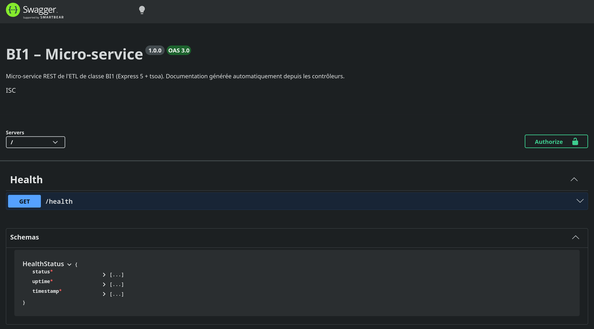
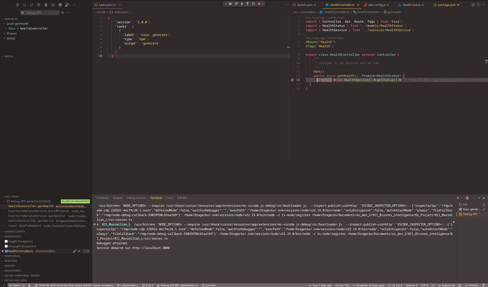

# BI1_Maximilian_L

Micro-service REST — BI1 (ETL de classe en architecture micro-services)

## Quick Start

```bash
# 1. Clone
git clone https://github.com/Dragecko/BI1_Maximilian_L
cd BI1_Maximilian_L

# 2. Install
npm install

# 3. Dev
npm run dev        # http://localhost:3000/health

# 4. Docs
#    http://localhost:3000/docs

# 5. Test
npm test

# 6. Build
npm run build
npm start
```

Prérequis : Node.js 22+, npm 10+, VS Code ou Cursor

Guide détaillé pour un nouveau développeur : [docs/INSTALL.md](docs/INSTALL.md)

## Stack

| Élément | Choix | Raison |
|---|---|---|
| Langage | TypeScript 5 | Typage statique, requis par tsoa pour générer la doc |
| Framework | Express 5 | Framework proposé par l'enseignant, gestion native des erreurs `async` |
| Routes + OpenAPI | tsoa 6 | Routes et Swagger générés depuis les décorateurs (`@Route`, `@Get`) |
| Doc interactive | swagger-ui-express 5 | Sert la spec générée sur `/docs` |
| Tests | Jest 30, ts-jest, Supertest | Tests TypeScript, appels HTTP sur l'app sans `listen()` |
| Dev | nodemon, ts-node | Régénération tsoa + redémarrage automatique |

## Architecture

```
src/
├── controllers/            # Presentation — HTTP layer (décorateurs tsoa)
│   └── HealthController.ts #   GET /health, délègue au service
├── services/               # Application — business logic
│   └── HealthService.ts    #   construit le statut (status, uptime, timestamp)
├── models/                 # Domain — types partagés
│   └── HealthStatus.ts     #   interface de réponse, réutilisée dans Swagger
├── generated/              # Generated — par tsoa, ignoré par git
│   ├── routes.ts           #   routes Express générées
│   └── swagger.json        #   spec OpenAPI 3
├── app.ts                  # App Express — routes, /docs, 404, gestion d'erreurs
└── server.ts               # Entry point — listen(PORT)

tests/
├── health.test.ts          # GET /health → 200, route inconnue → 404
└── docs.test.ts            # GET /docs → 200, spec contient /health

.vscode/
├── launch.json             # configuration « Debug API »
└── tasks.json              # tâche « tsoa: generate » avant le debug
```

## Request Flow

```
GET /health
  → app.ts                 middlewares Express (json)
    → generated/routes.ts  route générée par tsoa
      → HealthController   couche HTTP
        → HealthService    logique métier
      ← HealthStatus
  ← 200 application/json

Route inconnue → 404 { message: "Not Found" }
Erreur tsoa    → 422 { message: "Validation Failed" }
Autre erreur   → 500 { message: "Internal Server Error" }
```

## API

| Méthode | Route | Rôle | Réponse |
|---|---|---|---|
| GET | `/health` | Healthcheck du service | `200` `{ status, uptime, timestamp }` |
| GET | `/docs` | Swagger UI autogénéré | `200` HTML |

```json
{ "status": "ok", "uptime": 45.31, "timestamp": "2026-11-09T14:28:34.577Z" }
```

La spec est générée depuis les décorateurs et commentaires JSDoc des contrôleurs : une nouvelle route apparaît automatiquement dans `/docs`.



## Tests

```bash
npm test                           # génère les routes (pretest) puis lance Jest
npm test -- --coverage --verbose   # avec couverture détaillée
```

Tests in `tests/` cover:

- `GET /health` : statut 200, `status = "ok"`, `uptime` numérique, `timestamp` string
- Route inconnue : 404
- `GET /docs` : Swagger UI servi (200)
- Spec OpenAPI : la route `GET /health` est documentée

Test stack: Jest, ts-jest, Supertest.

## Debug

1. Ouvrir le dossier `BI1_Maximilian_L` dans VS Code / Cursor
2. Poser un point d'arrêt dans `src/controllers/HealthController.ts`
3. `Ctrl + Shift + D` → **Debug API** → `F5`
4. Ouvrir http://localhost:3000/health → l'exécution s'arrête sur le point d'arrêt

`launch.json` lance `tsoa: generate` avant le démarrage (`preLaunchTask`) et exécute le TypeScript via `ts-node/register` : les points d'arrêt se posent directement dans les `.ts`.



## Scripts

| Script | Rôle |
|---|---|
| `npm run dev` | nodemon : régénère tsoa + relance le serveur à chaque modification |
| `npm run generate` | Génère `src/generated/routes.ts` et `swagger.json` |
| `npm test` | `pretest` (generate) + Jest |
| `npm run build` | `prebuild` (generate) + compilation dans `dist/` |
| `npm start` | Lance `dist/server.js` |

## Conventions

- **Architecture** : controllers / services / models — Express n'impose pas de structure, inspiré de l'exemple MVC officiel
- **Contrôleurs** : fichiers `*Controller.ts` (motif lu par `tsoa.json`), aucune logique métier
- **App / serveur séparés** : `app.ts` exporte l'app, `server.ts` fait `listen()` → testable avec Supertest
- **Erreurs** : centralisées dans un middleware final (404 / 422 / 500)
- **Code généré** : `src/generated/` jamais commité, régénéré par `dev`, `test` et `build`
- **Config** : port via `PORT` (défaut `3000`)
- **Versions** : tsoa fixé en 6.x (le tag `latest` pointe vers une alpha 7.0), TypeScript 5
- **Dépendances** : pas de `npm audit fix --force` (vulnérabilités *moderate* indirectes)
- **nodemon** : configuré dans `nodemon.json` (ignore `src/generated/**`, sinon boucle de redémarrage)
- **Commits** : conventional (`feat:`, `fix:`, `docs:`, `test:`, `chore:`)

## Sources

Liens étudiés pour choisir la technologie et mettre en place cette première version.

| Thème | Lien | Retenu |
|---|---|---|
| Express | [Routing 5.x](https://expressjs.com/en/5x/guide/routing/) | Méthodes et chemins de routes, `express.Router`, enchaînement des handlers avec `next()` |
| Express | [FAQ](https://expressjs.com/en/starter/faq) | Aucune structure imposée (→ controllers / services / models) ; le 404 se gère avec un middleware en bas de la pile |
| Express | [Error handling](https://expressjs.com/en/guide/error-handling.html) | Middleware d'erreur à 4 arguments, défini en dernier ; les Promises rejetées appellent `next(err)` automatiquement |
| tsoa | [Getting started](https://tsoa-community.github.io/docs/getting-started.html) | `tsoa.json`, `experimentalDecorators`, `RegisterRoutes(app)`, `tsoa spec-and-routes`, contrôleur `@Route` / `@Get` |
| tsoa | [Live reloading](https://tsoa-community.github.io/docs/live-reloading.html) | Swagger UI servi sur `/docs` avec swagger-ui-express ; `nodemon.json` |
| Tests | [Jest — Getting started](https://jestjs.io/docs/getting-started) | `describe` / `test` / `expect` ; ts-jest pour TypeScript |
| Tests | [Supertest](https://www.npmjs.com/package/supertest) | `request(app)` teste l'app sans appeler `listen()` |
| Debug | [VS Code — Node.js debugging](https://code.visualstudio.com/docs/nodejs/nodejs-debugging) | `launch.json` de type `node`, `runtimeArgs`, `skipFiles` |
